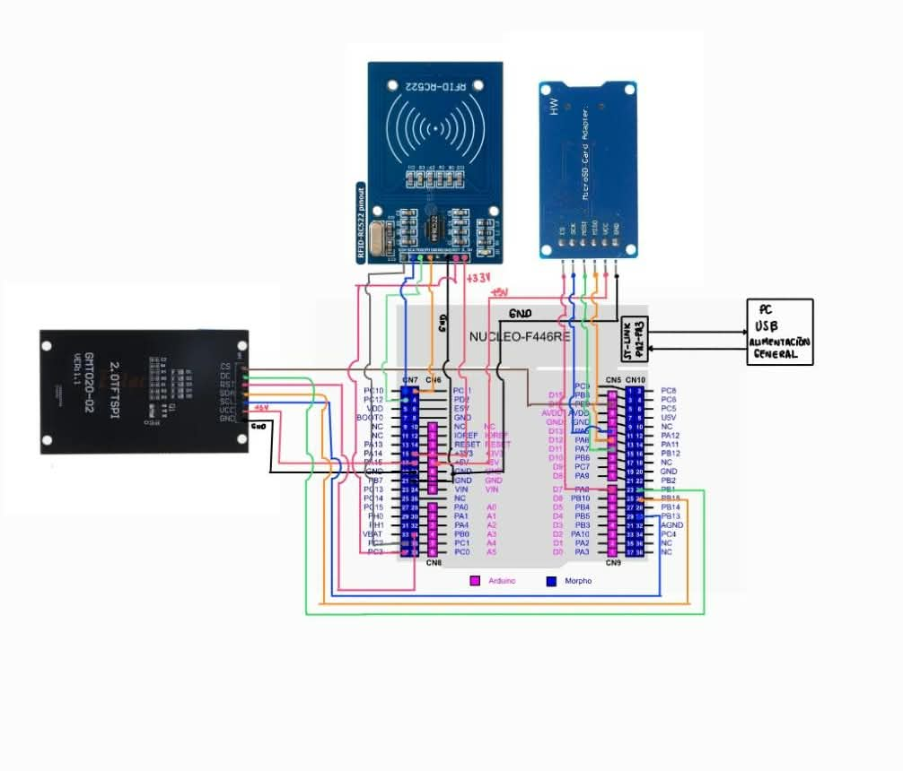
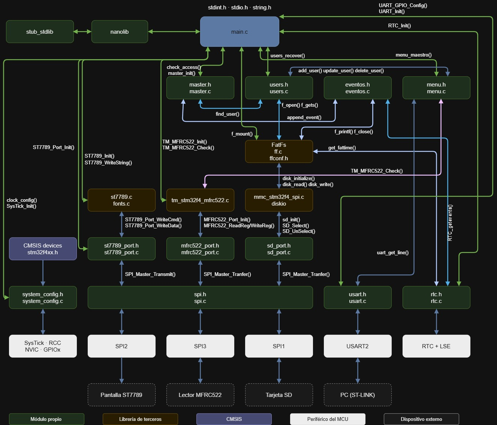
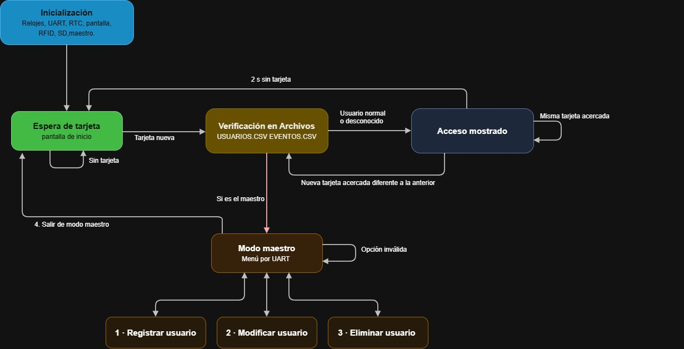

# Registro RFID y control de acceso 

Sistema de control de acceso mediante RFID, incorporando seguimiento de usuarios y horas de acceso en archivos de datos e interacción con el usuario en interfaz gráfica

**Integrantes:**  Ariana Sofia Garcia Duran y Daniel Santiago Salavarrieta Casasbuenas
<!-- **Informe:** [docs/informe.pdf](docs/informe.pdf) -->


## 1. Funcionalidades

- Lectura de tarjetas RFID (MFRC522).
- Registro en la SD: `EVENTOS.CSV` y `USUARIOS.CSV`.
- Pantalla para modo usuario: acceso concedido o denegado, con el nombre del usuario.
- Tarjeta maestra: menú por UART para registrar, modificar y eliminar usuarios.
- RTC propio para registros con fecha y hora, recuperación de usuarios con archivo temporal si se corta a mitad de un cambio.

## 2. Hardware
| Componente | Módulo | Interfaz de comunicación |
|---|---|---|
| MCU | NUCLEO-64 STM32F446RE (Cortex-M4, 84 MHz) | |
| Lector RFID | MFRC522 (RC522), 13.56 MHz | SPI |
| Pantalla | TFT IPS 2.0" ST7789VW, 240×320 | SPI |
| Tarjeta SD | Módulo con buffer 74LVC125A | SPI |
| Terminal | ST-LINK Virtual COM Port (USB) | UART |


## 3. Conexiones



| Dispositivo | Señal | Pin |
|---|---|---|
| SD conectado a SPI1 | SCK | PA5 |
|  | MISO  |  PA6  |
|  | MOSI  | PA7  |
|  | CS |  PA8 |
| Pantalla conectada a SPI2 | SCK-SCL  | PB13  |
| | MOSI -SDA |  PB15  |
| | CS |  PB9  |
| | DC |  PB1  |
| |  RST |  PB0 |
| RFID conectado a SPI3 | SCK  | PC10  |
|  |  MISO |  PC11  |
|  |  MOSI |  PC12  |
|  |  CS - SDA | PC2 |
|  |  RST | PC3 |
| UART con USART2 | TX / RX | USB  |

### Notas eléctricas

| Aspecto | Diseño | Descripción |
|---|---|---|
| Alimentación General | USB del ST-LINK  | Una sola fuente para todo el sistema |
| RFID MFRC522 | 3.3 V desde el pin de la STM| El módulo no trae regulador |
| Pantalla ST7789 | 5 V de la STM, contiene su propio regulador |  |
| Tarjeta SD | 5 V de la STM, contiene su propio regulador | |
| Niveles lógicos | Todas las señales van a 3.3 V, compatibles directamente con los GPIO del STM32 |  |
| Pull-up en MISO de la SD | Pull-up interno en PA6  | En modo SPI, la tarjeta deja su salida en alta impedancia cuando CS está en alto. Sin pull-up, MISO quedaría flotando y podría leerse basura durante la inicialización (recomendación de las notas de ChaN sobre MMC/SD) |
| Salidas | Push-pull Velocidad baja para CS, DC y RST; media para SCK, MOSI y MISO  | La velocidad media sobra para el SPI más rápido  y produce flancos menos bruscos, con menos ruido, que la alta |
| Tierra | GND común entre la Nucleo y los tres módulos |  |

## 4. Arquitectura
**Diagrama de bloques hardware/software:** 




El sistema usa un loop con interrupciones

- **SysTick (cada 1 ms)**: Actualiza los timers de software  y llama a `disk_timerproc()`, la base de tiempo de los timeouts de FatFs.
- **Timer de software (100 ms)**: Solo consulta el RFID cuando se activa su bandera, es decir, 10 veces por segundo, no se implementó la IRQ del módulo.
- **USART2**: Reune lo escrito en UART al recibir el enter, usando la información para realizar cambios en modo maestro
- **Datos compartidos ISR y  main**: Las banderas y el buffer de línea son `volatile`, porque los modifica una ISR y los lee el lazo principal.
- **Modo maestro**: `menu_maestro()` es bloqueante. Mientras está activo no se atienden tarjetas nuevas; solo siguen corriendo las interrupciones.



## 5. Requisitos de software utilizados

- **arm-none-eabi-gcc 13.2.1**: compilar y enlazar.
- **GNU make 4.3**: Ejecutar el Makefile.
- **OpenOCD 0.12.0**: Programar la placa y servidor de depuración.
- **gdb-multiarch 15.1**: Depurar.
- **Serial Monitor de Visual Studio Code**: terminal para el menú maestro. (puerto de conexión con ST-LINK, 115200 baudios, final de línea CRLF)
- Probado en Ubuntu 24.04.


## 6. Compilar y programar
> **Nota Ubuntu en WSL:** antes de `make flash`, conecta la placa a WSL desde PowerShell con usbipd
```bash
git clone https://github.com/ariii-g/RFID_Logging_and_access_control.git
cd RFID_Logging_and_access_control/RFID_Logging_access_ctrl
make clean
make            
make flash     

```

## 7. Depuración


Terminal 1: abrir el servidor de depuración:

       openocd -f interface/stlink.cfg -f target/stm32f4x.cfg

Terminal 2

       make debug

   GDB se conecta al puerto 3333 y detiene el micro en el reset.
   - `break check_access`: detener cuando se verifica una tarjeta
   - `continue`: seguir ejecutando
   - `print id_str`: ver el ID leído
   - `info registers`: ver los registros
   - `quit`: salir

También se depuró por UART los mensajes de error salen por el Serial Monitor.

## 8. Uso

1. Formatear la tarjeta SD en FAT32. Los archivos `USUARIOS.CSV` y `EVENTOS.CSV` se crean al arrancar.
2. Acercar una tarjeta, la pantalla muestra si tiene acceso y el evento se guarda en la SD.
3. Para entrar a modo maestro acercar la tarjeta maestra y usar el menú en el Serial Monitor.
   El ID maestro está definido en `master.h`; para usar otra tarjeta, cambiarlo y recompilar.


## 9. Uso de CMSIS y librerías 
- `STM32utils/`: paquete entregado en el curso. Del paquete solo se usan las definiciones de registros CMSIS (`stm32f4xx.h`, `core_cm4.h`) y `system_stm32f4xx.c`; no se compila ningún archivo del HAL . Todos los drivers de periféricos del MCU son propios.
- ST7789-STM32 (Floyd-Fish), licencia en `LICENSE_DISPLAY.txt`
- TM_MFRC522 (Tilen Majerle), GPLv3
- FatFs y el driver MMC (ChaN)

## 10. Declaración de uso de IA

**Herramienta:** Claude (Anthropic), usado en conversación de chat.

**Para qué se usó:**
- Explicar conceptos, registros y secciones del manual de referencia (RM0390) antes de escribir cada driver.
- Proponer código y estructura para la lógica de la aplicación (usuarios, eventos, menú maestro) y algunas funciones de drivers.
- Ayudar a encontrar y corregir errores durante las pruebas en la placa.
- Revisar y mejorar la redacción de la documentación.

**Cómo se usó:**
- Primero se pedía la explicación y después se escribía el código paso a paso.
- Todo el código propuesto se revisó antes de compilar, se adaptó a los drivers y se probó en la placa módulo por módulo antes de integrarlo.
- **Lo que no hizo la IA:** la elección de componentes y elección de puertos y pines, el diseño de la interfaz de la pantalla, las pruebas en hardware y las decisiones de diseño.

**Origen del código por archivo:**

- Propuesto con IA, adaptado y verificado
  - `users.c`, `eventos.c`, `master.c`, `menu.c`: todas sus funciones
  - `rtc.c`: `RTC_getdatetime`, `get_fattime`, `RTC_getevents`
  - `usart.c`: `uart_rx_line_isr`, `uart_get_line` Adaptadas a partir del ejemplo base 
  - `spi.c`: `SPI_Master_Config`, `SPI_Master_Transmit`
  - `main.c`: `init_SD`
  - `mmc_stm32f4_spi.c`: la adaptación de las funciones de bajo nivel a `sd_port`
- Escrito propio, con errores revisados o completado con IA:
  - `main.c`: `main`, `id_display`
  - `sd_port.c`, `st7789_port.c`, `mfrc522_port.c`
- Escrito propio, con la IA solo como explicación:
  - `rtc.c`: `RTC_Init`
  - `main.c`: `hello_display`
  - `ffconf.h`
  - La adaptación de las librerías de la pantalla y del RFID a sus capas de puerto
- Base de los ejemplos 
  - `crt0.S`, `linker_script.ld`, `Makefile` adaptado, `system_config.c`, `gpio_config.c`
  - las funciones base de `usart.c` y `spi.c`
  - `SysTick_Handler` y `USART2_IRQHandler` (modificada)

En el código, cada archivo indica en su comentario inicial qué funciones se hicieron con ayuda de IA.
